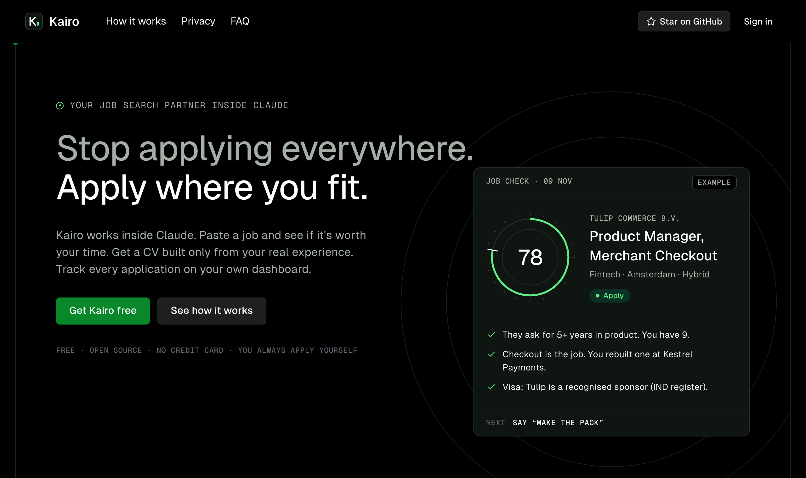
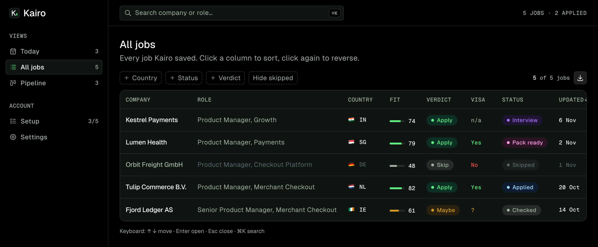
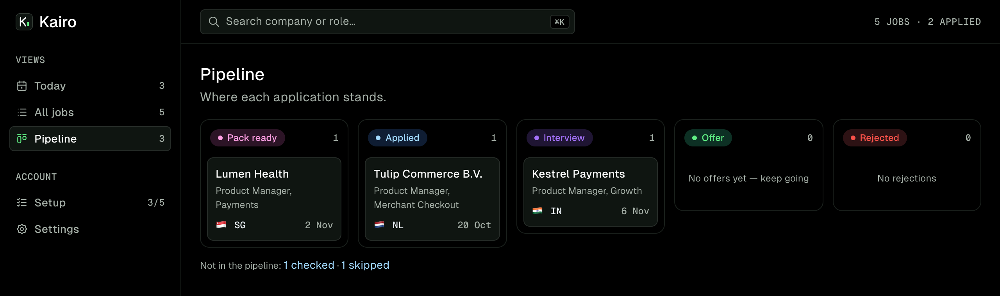

# Kairo

**Your job search partner inside Claude.** Kairo checks if a job is worth your time, builds a CV only from your real experience, and tracks every application. Free and open source.



## How it works

| Step              | What happens                                                                                                      |
| ----------------- | ----------------------------------------------------------------------------------------------------------------- |
| 1. Set up once    | Upload your CV and answer up to 10 short questions. Kairo saves your facts, so you never repeat yourself.         |
| 2. Check a job    | Paste a link or the job text. Get a fit score (0–100), **Apply / Maybe / Skip**, red flags and a visa check.      |
| 3. Make the pack  | A tailored CV (PDF), a cover letter and form answers. Every line is checked against your facts before you see it. |
| 4. Track to offer | Say "applied" or "got an interview". Your tracker updates with the date.                                          |

## Set up in 5 minutes (with the free dashboard)

1. Go to **[kairo.rohansurve.in](https://kairo.rohansurve.in)** and sign in with your email (a 6-digit code, no password).
2. Download the Kairo skill (a ZIP file) from your dashboard.
3. In Claude.ai open **Customize → Skills**, click **Upload**, choose the ZIP and switch it on. Code execution must be on (**Settings → Capabilities**).
4. Connect your dashboard: **Customize → Connectors → Add custom connector**. Name: `Kairo`. URL: `https://kairo.rohansurve.in/mcp`. Click **Connect** and sign in with the same email.
5. Create a Claude project, open a chat in it and say **"set up Kairo"**. Then paste your first job.





## Skill only (no dashboard)

You don't need the dashboard. Download `kairo-skill.zip` from the [latest release](https://github.com/rohansurve5/kairo/releases/latest), do step 3 above, then say **"set up Kairo"** in a Claude project. Kairo then keeps a simple tracker table in the chat, and nothing is sent to Kairo at all.

**Download Kairo only from [kairo.rohansurve.in](https://kairo.rohansurve.in) or this repo's [Releases](https://github.com/rohansurve5/kairo/releases).**

## Privacy

| Stays in your Claude, never sent to Kairo | Saved on your dashboard (only if you use it) |
| ----------------------------------------- | -------------------------------------------- |
| Your CV and your facts                    | The public job post                          |
| Salary answers and expectations           | Fit score, verdict, red flags, visa flag     |
| Cover letters                             | Status history with dates                    |
| Form answers                              | Your email, for sign-in                      |

The Kairo server uses no AI. All AI work happens in your own Claude account. You can download your data (CSV) or delete it at any time in **Settings**. Full details: [Privacy policy](https://kairo.rohansurve.in/privacy) · [Terms of use](https://kairo.rohansurve.in/terms).

## Limits

- **Kairo never applies for you.** It prepares; you decide and you send.
- **Version 1 has no job finder.** You bring the jobs: paste a link or the job text. If a link needs a login (LinkedIn often does), paste the text.
- **Check every output.** Fit scores, visa checks, CVs and answers come from AI and can be wrong. Read everything before you send it, and check visa rules on the official government page.
- **Claude only.** Kairo works in Claude.ai (web and desktop) with code execution on. Usage limits depend on your Claude plan.

## Countries and CV formats

Kairo builds an ATS-friendly CV in the right format for 9 countries:

| Country        | What changes on the CV                                                                   |
| -------------- | ---------------------------------------------------------------------------------------- |
| India          | No photo, date of birth, marital status or religion. CTC goes in form answers.           |
| Netherlands    | Short and factual. Nationality and "open to relocation" in the location line.            |
| Ireland        | Like the Netherlands. 2 pages is normal for experienced people.                          |
| Germany        | CEFR level for every language, place-and-date line. Photo and birth date off by default. |
| Poland         | GDPR consent clause at the bottom with the company name.                                 |
| France         | 1 page preferred under 10 years of experience. Photo off by default.                     |
| UAE            | A visa line ("needs an employment visa"). Photo off by default.                          |
| Singapore      | A visa line ("Requires Employment Pass").                                                |
| United Kingdom | A right-to-work line. 2 pages is normal.                                                 |

Rules like these change, so Kairo says "check current advice" where it matters.

## For developers

The skill lives in [`skill/kairo/`](skill/kairo/). Its scripts run on Python 3.9+ with only the standard library (the CV builder uses reportlab, with fallbacks).

```bash
uv venv --python 3.11 .venv && uv pip install --python .venv/bin/python reportlab pypdf python-docx
.venv/bin/python -m unittest discover -s tests -v      # all tests
.venv/bin/python tools/build_skill_zip.py              # build + validate dist/kairo-skill.zip
```

The tools the skill calls on the dashboard are described in [`docs/CONNECTOR-CONTRACT.md`](docs/CONNECTOR-CONTRACT.md). See [CONTRIBUTING.md](CONTRIBUTING.md), [SECURITY.md](SECURITY.md) and the [CHANGELOG](CHANGELOG.md).

## Licence

[MIT](LICENSE) © 2026 Rohan Surve. The bundled Geist font is under the SIL Open Font License 1.1. Kairo is not affiliated with Anthropic.

---

Built by **Rohan Surve** · [rohansurve.in](https://rohansurve.in)
